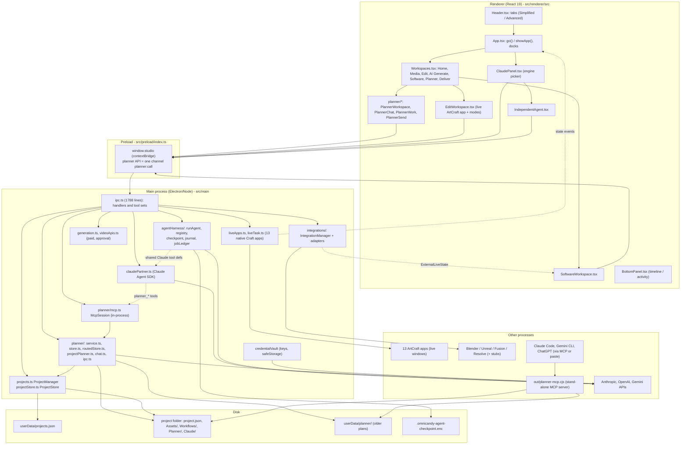
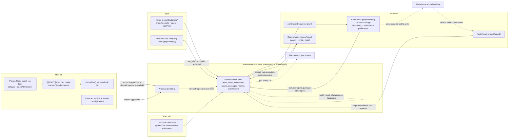
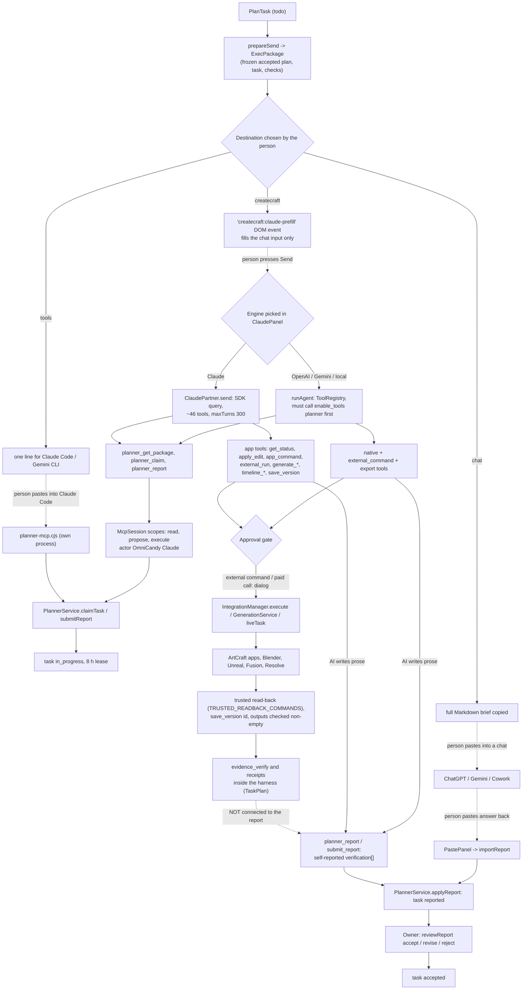
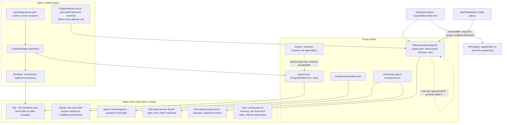

# 08. Architecture diagrams (existing code only)

All four diagrams describe what is in the repository now (HEAD `bf7b6b5`). Dashed arrows are "text hand-off by a person" or event-only
links, not function calls. Mermaid renders in GitHub, VS Code and most Markdown viewers.

## A. Current application architecture

## B. Current planner data flow

## C. Planner-to-agent-to-application execution flow (as it exists; the dashed parts are manual)

## D. Current project persistence and recovery flow

